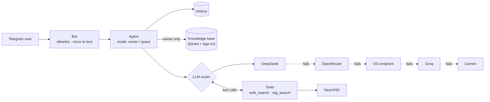

# vika_relay

An LLM gateway behind a Telegram assistant. One `ask()` call, five providers behind it: if one fails, runs out of balance or returns nothing, the next one answers. On top of that — tool calling, RAG over a private knowledge base, guest access with a hard tool allowlist, and a cost guard for peak pricing hours.

Extracted from the author's personal assistant; this repository contains the gateway core and a minimal bot around it.

## Features

- **Fallback chain** — DeepSeek → OpenRouter → DO endpoint → Groq → Gemini, all through OpenAI-compatible APIs. Each provider gets 3 attempts with 1 s / 3 s backoff. Auth, billing and unknown-model errors (401/402/403/404) skip straight to the next provider. An empty answer counts as a failure, not as a reply.
- **Tool calling loop** — the model calls tools, results go back to it, until it answers in text. At the round limit it writes an honest summary of what was done instead of cutting off.
- **Cost guard** — during DeepSeek peak hours (weekdays 01–04 and 06–10 UTC) the pro model and heavy requests (6,000+ characters) are routed around DeepSeek, with Groq first.
- **Per-request routing** — preferred provider, model, reasoning effort and cancellation are set per turn in thread-local state, so concurrent chats don't affect each other.
- **Access modes** — `owner` gets web search and the knowledge base; `guest` gets web search only. The allowlist is enforced twice: in the tool list the model sees and in the executor. Unknown modes get guest rights.
- **RAG** — bge-m3 embeddings via Ollama, Qdrant search with a relevance threshold; short messages skip retrieval. Retrieved context goes at the end of the user turn, so the prompt prefix stays stable and provider-side prompt caching keeps hitting.
- **Telegram bot** — text and voice (Whisper via Groq), per-user history, user allowlist.

## Architecture



| Path | What it does |
| --- | --- |
| `gate/router.py` | Provider chain, retries, tool loop, peak guard |
| `gate/agent.py` | Prompt, history and RAG assembly, access modes |
| `gate/rag.py` | Embeddings via Ollama, search in Qdrant |
| `gate/search.py` | Web search via SearXNG |
| `bot/telegram.py` | Telegram front end |

## Quick start

```bash
git clone https://github.com/Redrock453/vika_relay.git
cd vika_relay
cp .env.example .env   # add a Telegram token, your Telegram ID and at least one provider key
```

With Docker (bot + SearXNG + Qdrant):

```bash
docker compose up -d --build
```

Without Docker (Python 3.11+, ffmpeg for voice):

```bash
python -m venv .venv && source .venv/bin/activate
pip install -r requirements.txt
python run.py
```

RAG is optional: without Ollama and Qdrant the bot answers without a knowledge base.

## Configuration

| Variable | Purpose |
| --- | --- |
| `TELEGRAM_BOT_TOKEN`, `ALLOWED_IDS` | Bot token and allowed Telegram user IDs |
| `DEEPSEEK_API_KEY`, `OPENROUTER_API_KEY`, `DO_AI_API_KEY` + `DO_AI_BASE_URL`, `GROQ_API_KEY`, `GEMINI_API_KEY` | Providers; any without a key is skipped |
| `VIKA_*_MODEL` | Model override per provider |
| `VIKA_DEEPSEEK_PEAK_GUARD` | `0` turns the cost guard off |
| `OLLAMA_URL`, `QDRANT_HOST`, `VIKA_RAG_COLLECTION` | Knowledge base |
| `SEARXNG_URL`, `SEARXNG_SECRET` | Web search |

The full list with defaults is in [`.env.example`](.env.example).

## Tests

```bash
pip install -r requirements-dev.txt
pytest
```

The tests cover routing (fallback order, retries, fail-fast errors, empty answers, tool loop, round limit, peak guard) and access modes, using scripted fake providers — no API keys or network needed.

## Українською

**vika_relay** — шлюз до LLM для Telegram-асистента: п'ять провайдерів з автоматичним перемиканням, виклик інструментів, RAG на Qdrant, гостьовий режим з жорстким списком дозволених інструментів і захист від пікових тарифів. Виділено з особистого асистента автора.
